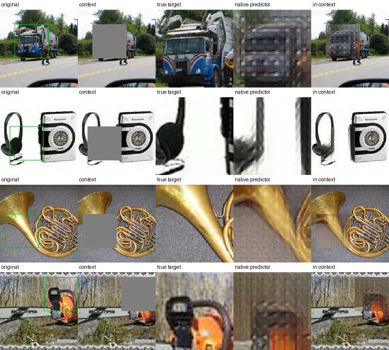

# I-JEPA Decoder (Unofficial)

**Turn Meta I-JEPA predictor features into an RGB visualization.** This
independent research prototype includes only the best native decoder,
image inference, and the code/data manifest needed to reproduce its training.
No RCDM, DINO, RAE, or diffusion generator is required.



Four illustrated validation examples from the **same best predictor model**.
The predictor sees only visible patches and known mask positions; the
**in context** column inserts its decoded crop without changing visible pixels.
The true target is a comparison, not an input to prediction.

## Pretrained Decoder

**[Download v0.1.0](https://github.com/yaskovdev/ijepa-decoder/releases/tag/v0.1.0)**
or use `ijepa-decoder download` below. The release contains
[105 MB safetensors weights](https://github.com/yaskovdev/ijepa-decoder/releases/download/v0.1.0/model.safetensors),
[config](https://github.com/yaskovdev/ijepa-decoder/releases/download/v0.1.0/config.json),
the model license, and
[SHA256SUMS](https://github.com/yaskovdev/ijepa-decoder/releases/download/v0.1.0/SHA256SUMS).
Checksums are verified by the downloader. Weights are release assets, not git blobs.

The decoder has **26.3 million parameters**, is initialized from MAE-base, and
maps 49 unpooled I-JEPA ViT-H/14 predictor tokens plus their native positions
to a **98x98 RGB crop**. The released mixed-training checkpoint was selected
at step **400**, not the final step 800 and not a target-encoder oracle.
On all 64 validation photographs, RGB MAE is **0.128089**, LPIPS **0.335584**.
[Model card, training details, limitations, and licensing](MODEL_CARD.md).

This is **not an official Meta decoder**, general-purpose inpainting, or the
unique hidden image. Colors, details, alignment, and seams may be wrong.
Only patch-aligned 7x7 masks in the 224x224 center-cropped view are supported.

## Install and Visualize Your Image

Python 3.12 / PyTorch 2.7.1 was tested on Apple Silicon MPS. CUDA and CPU are
supported code paths, but their runtime was not benchmarked. Choose appropriate
Linux wheels using the [PyTorch installation guide](https://pytorch.org/get-started/locally/).

```shell
git clone https://github.com/yaskovdev/ijepa-decoder.git
cd ijepa-decoder
python3 -m venv .venv
source .venv/bin/activate
pip install -c constraints.txt -e .
ijepa-decoder download
```

You also need the **full official I-JEPA encoder/predictor checkpoint**
(about 10.4 GB), not an encoder-only Hugging Face model. I-JEPA is downloaded
separately and retains its own noncommercial license:

```shell
mkdir -p artifacts/checkpoints
git clone https://github.com/facebookresearch/ijepa.git artifacts/ijepa
git -C artifacts/ijepa checkout 52c1ae95d05f743e000e8f10a1f3a79b10cff048
curl --fail --location --continue-at - --output artifacts/checkpoints/IN1K-vit.h.14-300e.pth.tar https://dl.fbaipublicfiles.com/ijepa/IN1K-vit.h.14-300e.pth.tar
ijepa-decoder decode --image your-image.jpg --top 4 --left 4 --output artifacts/prediction.png
```

`--top` / `--left` are patch coordinates (0 through 9) in the **224x224
center-cropped view**, not original-image pixel coordinates. The hidden block
is always 7x7 patches. `--device auto` selects CUDA, MPS, or CPU; use an explicit
device when needed. Inference loads the frozen context encoder and predictor,
but **no target encoder**. It also saves the native RGB crop and a 224x224
composite beside the comparison grid.

## Reproduce Training

The shipped [manifest](ijepa_decoder/manifest.json) records the exact 2,048
training and 64 validation photographs, preprocessed-pixel hashes, and masks
used by this model. It contains no dataset images. Preparation rejects changed
pixels or train/validation overlap and verifies hidden-pixel isolation.

```shell
pip install -c constraints.txt -e '.[train]'
mkdir -p artifacts/data
curl --fail --location --continue-at - --output artifacts/data/imagenette2-320.tgz https://s3.amazonaws.com/fast-ai-imageclas/imagenette2-320.tgz
tar -xzf artifacts/data/imagenette2-320.tgz -C artifacts/data
ijepa-decoder prepare
ijepa-decoder assets
ijepa-decoder train --feature-source target --steps 1000 --out-dir artifacts/target_1000
ijepa-decoder train --feature-source mixed --steps 800 --learning-rate 5e-5 --init artifacts/target_1000/best.pt --out-dir artifacts/mixed_800
ijepa-decoder evaluate
```

`evaluate` defaults to the released model; use
`--decoder artifacts/mixed_800/best.pt` to evaluate a retrained checkpoint.
Training uses original native RGB crops, L1 + 0.5 frozen AlexNet LPIPS,
and fixed ImageNet normalization, not unknown hidden-patch statistics.
The target stage is only a training oracle; mixed batches retain reconstruction
ability while adapting to predictor tokens. All I-JEPA models remain frozen.

The measured training loops took 118 + 95 seconds on an M3 Max **after feature
caching**, excluding downloads and frozen I-JEPA extraction. Exact bitwise
retraining is not promised across hardware or package versions. Use new output
directories for repeat experiments; `--init` loads weights, not optimizer state.
Datasets, features, weights, and generated results stay under ignored `artifacts/`.

### Scaled Training (Experimental)

This opt-in experiment keeps the released `v0.1.0` model unchanged. It uses all
9,469 distinct Imagenette training photographs, four masks per photograph,
and 512 fixed validation photographs. The original 64 validation examples and
existing training masks are preserved. Expanded training is not yet a claim of
better reconstruction quality.

After the setup above:

```shell
ijepa-decoder manifest --output artifacts/scaled/manifest.json
ijepa-decoder prepare --manifest artifacts/scaled/manifest.json --out-dir artifacts/scaled/features --batch-size 8 --shard-size 128
for source in predictor mixed; do
  ijepa-decoder train --feature-source "$source" --cache-dir artifacts/scaled/features \
    --init artifacts/checkpoints/native --out-dir "artifacts/scaled/$source" \
    --steps 15000 --batch-size 16 --learning-rate 5e-5 --schedule cosine \
    --min-learning-rate 1e-6 --ema-decay 0.999 --eval-every 250
done
ijepa-decoder compare --decoder artifacts/scaled/predictor/best.pt --output artifacts/scaled/predictor_comparison.png
ijepa-decoder compare --decoder artifacts/scaled/mixed/best.pt --output artifacts/scaled/mixed_comparison.png
```

Preparation processes bounded shards, reuses each target-encoder pass across
its photograph's masks, and consolidates memory-mappable caches after freeing
the frozen networks. Originals are stored once; final caches occupy about
11 GB. Temporary shards need another approximately 11 GB during preparation.
Repeat the preparation command with `--resume` after interruption.

Training compares raw and EMA weights on the same validation data. `best.pt`
contains the selected decoder; `last.pt` also stores optimizer, cosine schedule,
EMA, and random states. Resume in the same output directory with the original
arguments, replacing `--init ...` with `--resume .../last.pt`. `--stop-after`
pauses at an absolute step without shortening the full `--steps` schedule.
Constant learning rate and no EMA remain the defaults for the published recipe.
Comparisons use identical predictor features for both models, include wrong-photo
and shuffled-token controls, and report paired bootstrap intervals grouped by
original photograph. The target-encoder control is explicitly separate from the
predictor-only visualization. Use the original small validation cache with
`compare --cache artifacts/features/val.pt` for the fixed 64-image comparison.

## Tests and Attribution

```shell
python -m unittest discover -s tests -v
```

The focused tests use synthetic data and small models without model downloads.
This standalone project retains the git history and original MIT notices from
[RCDM](https://github.com/facebookresearch/RCDM) /
[OpenAI guided-diffusion](https://github.com/openai/guided-diffusion);
unrelated experiment code is absent from the current tree.

**Code: [MIT](LICENSE). Released model weights: CC-BY-NC 4.0.**
Official [I-JEPA code/weights](https://github.com/facebookresearch/ijepa/blob/main/LICENSE)
also remain CC-BY-NC 4.0. The pinned
[MAE model card](https://huggingface.co/facebook/vit-mae-base/blob/25b184bea5538bf5c4c852c79d221195fdd2778d/README.md)
lists Apache-2.0. This I-JEPA-based workflow is for noncommercial research;
the code license does not relicense models or
[Imagenette/ImageNet](https://github.com/fastai/imagenette) photographs.

Related papers: [I-JEPA](https://arxiv.org/abs/2301.08243),
[MAE](https://arxiv.org/abs/2111.06377), [RCDM](https://arxiv.org/abs/2112.09164).
